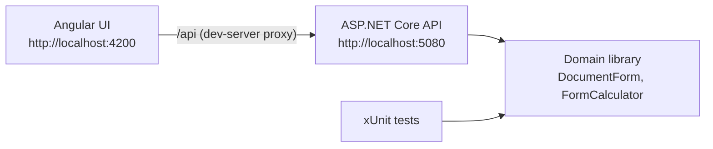

# Simple Document Form

A document form consists of **user fields** (entered by the user) and **calculated fields** (the sum of two other fields). This solution contains:

1. **Domain** – C# data structures and a function that calculates the value of a field, with unit tests.
2. **API** – an ASP.NET Core REST API that serves predefined forms and calculates completed forms.
3. **UI** – an Angular application to view forms, enter user fields and display the calculated values.



## Solution structure

| Project | Description |
|---|---|
| `SimpleDocumentForm` | Class library with the domain model and calculation logic |
| `SimpleDocumentForm.Tests` | xUnit tests for the domain |
| `SimpleDocumentForm.Api` | ASP.NET Core Web API (controllers) with the predefined forms |
| `SimpleDocumentForm.Web` | Angular application (not part of `SimpleDocumentForm.slnx`; built with the Angular CLI) |

## Prerequisites

- [.NET 8 SDK](https://dotnet.microsoft.com/download/dotnet/8.0)
- [Node.js](https://nodejs.org/) 22.12 or later (tested with 22.13) and npm

## Getting started

Run the commands from the repository root.

1. **Run the tests**
   ```powershell
   dotnet test SimpleDocumentForm.slnx
   ```
2. **Start the API** (listens on `http://localhost:5080`)
   ```powershell
   dotnet run --project SimpleDocumentForm.Api\SimpleDocumentForm.Api.csproj --launch-profile http
   ```
   In Visual Studio: set `SimpleDocumentForm.Api` as the startup project and run it with the `http` profile.
3. **Start the UI** in a second terminal
   ```powershell
   cd SimpleDocumentForm.Web
   npm install
   npm start
   ```
4. Open **http://localhost:4200**.

## Domain

| Type | Purpose |
|---|---|
| `FormField` | Base record for a field; every field has a unique `Name` |
| `UserField` | A field whose value is entered by the user |
| `CalculatedField` | A field calculated as `LeftOperand + RightOperand`; operands can be user or calculated fields |
| `DocumentForm` | A named set of fields, validated on creation |
| `FormCalculator` | `CalculateFieldValue(form, userValues, fieldName)` returns the value of any field |
| `CircularDependencyException` | Thrown when calculated fields depend on each other; `Cycle` lists the fields (e.g. `A -> C -> A`) |

`DocumentForm` rejects invalid definitions when it is created:

- duplicate field names;
- calculated fields that reference unknown fields;
- circular dependencies.

As a result, `FormCalculator` only ever works with valid forms. It evaluates fields recursively and caches intermediate results. Values are `decimal` to avoid floating-point rounding errors.

```csharp
var form = new DocumentForm("Form 2",
[
	new CalculatedField("A", "B", "C"),
	new UserField("B"),
	new CalculatedField("C", "D", "E"),
	new UserField("D"),
	new UserField("E"),
]);

var userValues = new Dictionary<string, decimal> { ["B"] = 1, ["D"] = 2, ["E"] = 3 };

decimal a = FormCalculator.CalculateFieldValue(form, userValues, "A"); // 6
```

`CalculateFieldValue` throws an `ArgumentException` when the field does not exist or a required user value is missing.

### Predefined forms

| Id | Name | Definition | Status |
|---|---|---|---|
| 1 | Form 1 | `A = B + C`, `D = E + F` | Valid |
| 2 | Form 2 | `A = B + C`, `C = D + E` | Valid |
| 3 | Form 3 | `A = B + C`, `C = A + D` | **Invalid**: circular dependency `A -> C -> A` |

The forms are defined in `SimpleDocumentForm.Api/Forms/PredefinedForms.cs`. Invalid definitions are logged as a warning at startup.

## API

Base URL: `http://localhost:5080`. Sample requests for every case are in [`SimpleDocumentForm.Api/SimpleDocumentForm.Api.http`](SimpleDocumentForm.Api/SimpleDocumentForm.Api.http); Visual Studio can send them directly.

| Method | Route | Description |
|---|---|---|
| `GET` | `/api/forms` | Lists all forms with their status |
| `GET` | `/api/forms/{id}` | Gets the fields of a form; for an invalid form, also the error and the cycle |
| `POST` | `/api/forms/{id}/completions` | Calculates all field values from the user's input |

### Example

```http
POST /api/forms/1/completions
Content-Type: application/json

{ "values": { "B": 1, "C": 2, "E": 3, "F": 4 } }
```

```json
{
  "id": 1,
  "name": "Form 1",
  "fields": [
	{ "name": "A", "type": "calculated", "value": 3 },
	{ "name": "B", "type": "user", "value": 1 },
	{ "name": "C", "type": "user", "value": 2 },
	{ "name": "D", "type": "calculated", "value": 7 },
	{ "name": "E", "type": "user", "value": 3 },
	{ "name": "F", "type": "user", "value": 4 }
  ]
}
```

### Errors

Errors are returned as [ProblemDetails](https://www.rfc-editor.org/rfc/rfc9457) (`application/problem+json`).

| Status | When | Example message |
|---|---|---|
| `400 Bad Request` | A user value is missing | `A value is required for user field 'C'.` |
| | A field does not exist | `Field 'Z' does not exist on form 'Form 1'.` |
| | A calculated field is set | `Field 'A' is calculated and cannot be set.` |
| | A value is not a number, or the body is missing or malformed | Model binding errors, e.g. key `$.values.B` |
| | A result exceeds the `decimal` range | `The value of field 'A' exceeds the supported numeric range.` |
| `404 Not Found` | The form id does not exist | `Form with id '99' does not exist.` |
| `409 Conflict` | The form definition is invalid | `Form 'Form 3' cannot be calculated: Circular dependency detected: A -> C -> A.` |

Validation errors for individual fields use the key `Values.<field>`, so clients can show them next to the field.

## UI

- **Form list** – all forms; invalid forms are marked with the reason.
- **Form details** – a table of fields:
  - user fields have an input;
  - calculated fields show their formula (e.g. `Calculated: B + C`) and, after **Calculate**, their value.
- **Calculate** sends the values to the API and shows the completed form. **Clear** resets the inputs. Changing a value clears the previous results.
- **Invalid forms** (Form 3) show a warning with the cycle, mark the affected fields, and disable the inputs and buttons.

### Error handling

- **Client-side validation** before calling the API: required values, valid numbers, and values within range. Messages appear next to each field after it is touched, plus a summary.
- **Server validation errors** (`400`) appear next to the related field; other messages appear in a list below the form.
- **Not found** (`404`), **invalid form** (`409`), **server unavailable** and **network errors** show a clear message, with **Retry** where it makes sense.
- Unknown routes redirect to the form list; a non-numeric id shows "does not exist".

UI styling was out of scope, so the UI uses plain HTML with minimal styles.

### Connecting to the API

During development the Angular dev server forwards `/api` requests to `http://localhost:5080` (see [`SimpleDocumentForm.Web/proxy.conf.json`](SimpleDocumentForm.Web/proxy.conf.json)). The browser only talks to `http://localhost:4200`, so the API needs no CORS configuration. If you run the API on another port, update `target` in `proxy.conf.json`.

## Design decisions

- **Validate at creation.** A `DocumentForm` with a cycle or an unknown operand cannot exist, so calculation never has to handle these cases. Form 3 is a definition error, not a calculation error.
- **Show invalid forms instead of hiding them.** The API returns Form 3 with `status: "invalid"`, the error and the cycle, and rejects its calculation with `409 Conflict`. The problem lies in the form definition, not in the user's input (`400`), and the form exists (not `404`).
- **`POST /completions`.** The user's values are sent in a JSON body and the server returns the completed form; nothing is stored.
- **`decimal` values** for exact sums (e.g. `0.1 + 0.2 = 0.3`).
- **In-memory repository** behind `IFormRepository`, built at startup so invalid definitions are reported immediately. It can be replaced with a database-backed implementation.
- **Dev-server proxy instead of CORS** – no API changes are needed for local development.

## Troubleshooting

| Problem | Solution |
|---|---|
| `npm install` fails with `Cannot read properties of null (reading 'edgesOut')` | A bug in npm 10.9.2. Run `npx npm@11 install` or upgrade npm. |
| The UI shows "The server is currently unavailable" | The API is not running on `http://localhost:5080`. Start it with the `http` profile. |
| `A launch profile with the name 'https' doesn't exist` | Only the `http` profile is enabled in `launchSettings.json`. Use `--launch-profile http`. |
| Form 3 is shown as invalid | Expected: it has a circular dependency (`A = B + C`, `C = A + D`). |
